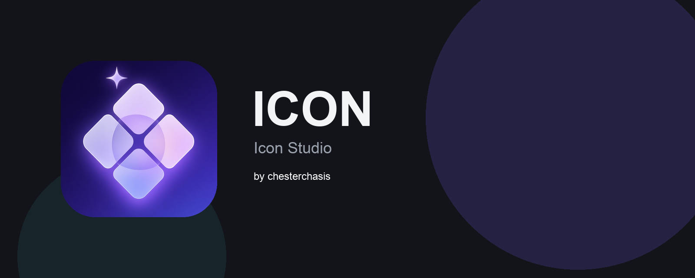

<p align="center">
  
</p>

<p align="center">
  <a href="https://github.com/chesterchasis/Icons/releases/tag/v1.0.0"></a>
  <a href="LICENSE"></a>
  <a href="https://github.com/chesterchasis"></a>
</p>

<p align="center">
  Aplicación de escritorio para generar un pack de iconos<br>
  a partir de una sola imagen.
</p>

---

## Qué hace

Abres una imagen, eliges plataforma y forma, ajustas el encuadre y exportas un ZIP listo para cada sistema.

| Destino | Salida |
| --- | --- |
| Windows | `icon.ico` y PNG de 16 a 1024 px |
| macOS | PNG de 128, 256, 512 y 1024 px |
| iOS | App icons de 60 a 1024 px |
| Android | `ic_launcher` en mdpi–xxxhdpi |
| Todas | Las cuatro carpetas en un ZIP |

## Descargar

Versión **1.0.0**. No hace falta instalar Python.

| Sistema | Archivo |
| --- | --- |
| macOS | [ICON-1.0.0-macos.zip](https://github.com/chesterchasis/Icons/releases/download/v1.0.0/ICON-1.0.0-macos.zip) |
| Windows | [ICON-1.0.0-windows.zip](https://github.com/chesterchasis/Icons/releases/download/v1.0.0/ICON-1.0.0-windows.zip) |

En macOS, si el sistema bloquea la app, haz clic derecho en `ICON.app` y elige Abrir.

## Empezar desde el código

Python 3.9 o superior.

**macOS**

```bash
./start_macos.sh
```

**Windows**

```powershell
python -m venv .venv
.\.venv\Scripts\Activate.ps1
pip install -r engine/requirements.txt
.\.venv\Scripts\python.exe .\engine\main.py
```

## Compilar

| Sistema | Comando | Resultado |
| --- | --- | --- |
| macOS | `./build_macos.sh` | `engine/dist/ICON.app` |
| Windows | `.\build_windows.ps1` | `engine/dist/ICON.exe` |

## Licencia

Uso gratuito bajo [MIT](LICENSE).

Hecho por **chesterchasis**.
